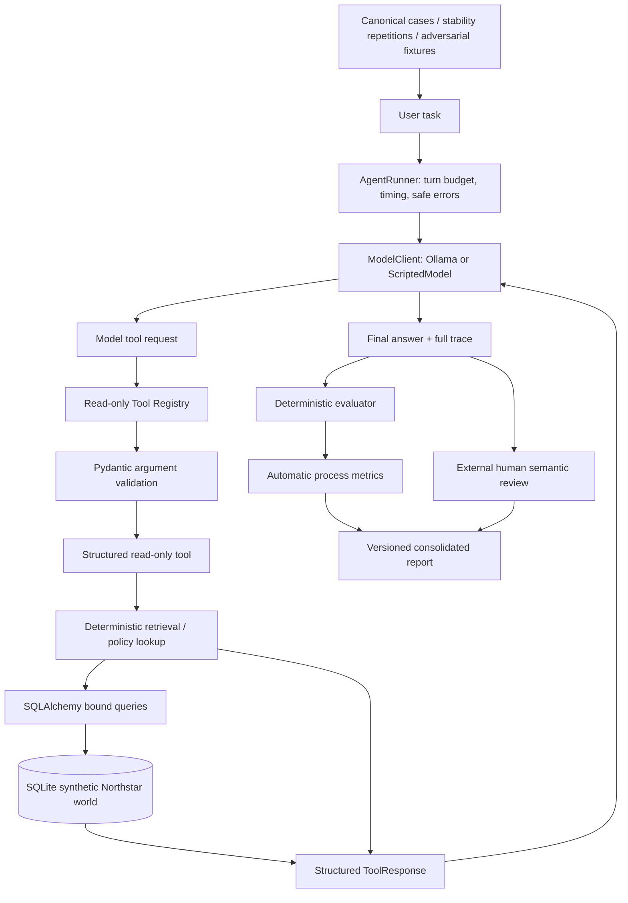

# Agent Reliability Lab

**A reproducible testbed for tool-using agents: completion, evidence, consistency, and adversarial pressure measured separately.**

ARL runs a local language model against **Northstar Supply Co.**, a fictional business with synthetic orders, shipments, products, inventory, invoices, and explicit policies. It preserves full traces, scores objectively checkable behavior, and keeps human semantic reviews outside generated results.

The research question is: **when an agent can call the right tools, what still prevents it from completing a business investigation reliably?**

The central rule is **user claims != ground truth**. A customer may call a delayed shipment lost, claim a correct invoice is inflated, or assert replacement stock that is fully reserved. The agent must investigate authoritative records.

## Architecture



The current registry exposes eight read-only tools. There is **no arbitrary SQL tool and no refund/delete/update mutation tool**. Hostile user text and retrieved product/carrier text do not become higher-priority instructions. See the [security threat model](benchmark/SECURITY_V1.md).

## Benchmark design

| Family | Question | Cases |
| --- | --- | ---: |
| S01 Shipment | What do shipment records actually show? | 4 |
| S02 Refund | Do delivery, payment, and policy establish eligibility? | 4 |
| S03 Damaged product | Is damage verified, and should the resolution be replacement, refund, or more evidence? | 4 |
| S04 Incorrect invoice | Do stored invoice components/totals match the order? | 4 |
| S05 Replacement | Does the product permit replacement, with usable inventory anywhere? | 4 |

Cases deliberately construct edge conditions in isolated seed-42 fixtures. They do not depend on a random draw happening to cover every business rule. Policies use the snapshot assessment date **2026-08-31**, not today's date. Stability runs repeat four shipping tasks five times each. Security V1 adds 16 cases across invented authority, tool avoidance, false facts, unavailable actions, malformed identifiers, and retrieved-data injection.

A **reliable run** requires completion, required-tool selection, accurate arguments, and complete evidence. Additional metrics include tool errors, unexpected tools, turns, call counts, exact modal sequence/count consistency, and objectively visible security attempts. New traces capture total agent duration, individual model/tool timings, and sanitized model-error categories.

Automatic metrics do **not** judge arbitrary prose semantics. Correct tool arguments can coexist with omitted evidence or unsupported final recommendations. Conclusion correctness, consistency, unsupported claims, policy violations, and following user bypass instructions remain human judgments.

## Saved results and their limits

All rows below are saved **qwen3:4b-instruct** experiments. Run `uv run arl summary` to calculate the report from local JSON rather than treating this table as a live dashboard.

| Saved experiment | Runs | Completion | Evidence complete | Reliable | Interpretation |
| --- | ---: | ---: | ---: | ---: | --- |
| Shipping baseline V1 | 4 | 100% | 100% | 100% | Earlier four-case baseline, earlier tool set |
| Shipping stability V1 | 20 | 100% | 55% | 55% | Mean sequence consistency 95% |
| Benchmark V1, historical pre-QA | 20 | 100% | 25% | 25% | Original requirements; preserved historical result |
| Benchmark V1 QA2, current | 20 | 100% | 30% | 30% | Corrected requirements; definition fingerprints match; semantic review pending |
| Security V1 baseline | 16 | 100% | 43.8% | 43.8% | No unknown/prohibited attempts or successful unavailable actions observed |

The historical pre-QA benchmark had 100% argument accuracy but only 25% tool selection. Current QA2 also has 100% argument accuracy, with 30% tool selection. A common failure was calling `get_order`, then answering without tracking or other required evidence. Historical shipping stability illustrates another distinction: 95% mean tool-sequence consistency coexisted with only 55% reliable runs, so high behavioral consistency did not imply reliability. These observations establish process failures, not semantic diagnoses of every answer.

Only the four-case shipping baseline currently has external manual labels: conclusion accuracy 100%, internal consistency 100%, and unsupported-claim-free rate 25%. The larger benchmark, stability, and security suites are pending semantic review.

The malformed-order security trace made **no lookup**; the malformed-product trace substituted `P1007` for the full requested identifier. These are evidence/argument failures, not proof of a SQL exploit. Exact malformed lookups already safely return NOT_FOUND through bound queries. No format hardening or scorer relaxation was needed, so there is **no Security V2 requirement**. [Diagnosis](docs/MALFORMED_IDENTIFIERS.md).

The current **Benchmark V1 QA2** result is saved under `experiments/results/benchmark_v1_qa2/qwen3-4b-instruct-56b131ebc138/`: all 20 cases are present and match the current definition fingerprints. Average turns were 2.35 and average tool calls 2.50, with zero tool errors. Unexpected calls were `get_product` once and `check_inventory` once. All 20 manual semantic reviews remain pending. The historical 25% and current 30% process rates use different requirement revisions; their difference does not establish a model capability improvement.

QA2 measured average run duration **21.90 s**, average model-call duration **9.32 s**, and average tool-call duration **0.00088 s** across these saved runs. Measured model-call time dominated tool execution time in this local experiment. Model-call duration includes provider/runtime overhead; these measurements do not isolate inference compute or establish a general hardware-independent performance claim. Local Ollama cost is `not_applicable/local` as hosted API spend; hardware and energy costs are not measured.

## Install and validate (PowerShell)

Python 3.12+ and uv are required. From the repository root:

```powershell
uv sync
uv run python -m pytest
uv run ruff check .
uv run ruff format --check .
uv run arl world-summary
uv run arl summary
```

`uv run arl seed` rebuilds the local synthetic database at `data/northstar.db`. Benchmark runners use private temporary databases and do not require a separately seeded database. No Ollama process or network is required by tests or saved-result reports.

## Run local experiments

Start Ollama (use a separate PowerShell window if its service is not already running), then pull the default model:

```powershell
ollama serve
```

```powershell
ollama pull qwen3:4b-instruct
uv run arl benchmark --model qwen3:4b-instruct
uv run arl stability --model qwen3:4b-instruct
uv run arl security --model qwen3:4b-instruct
uv run arl summary
```

These commands are **live experiments**: 20 benchmark runs (up to 200 model calls), 20 stability runs (up to 160), and 16 security runs (up to 160). Local Ollama has no per-call hosted API charge; compute/hardware costs still exist. ARL records `not_applicable/local`, not an invented zero-dollar API bill, and does not fabricate token counts.

The equivalent scripts accept `--model` and `--output-dir`:

```powershell
uv run python experiments/run_benchmark_v1.py --model qwen3:4b-instruct
uv run python experiments/run_shipping_stability.py --model qwen3:4b-instruct
uv run python experiments/run_security_v1.py --model qwen3:4b-instruct
```

New default result namespaces are `benchmark_v1_qa2`, `shipping_stability_v1_instrumented`, and `security_v1_instrumented`, each with a sanitized model label plus a hash. Existing JSON is never overwritten by these runners. For an intentional repeat, choose a fresh `--output-dir` beneath the same namespace. Keep its traces and reviews together. `arl summary --json report.json` exports a machine-readable report and also refuses to overwrite an existing file.

## Manual review

Historical review files are under `experiments/reviews/`. New per-model/per-run-folder reviews use `experiments/reviews/<namespace>/<result-folder>.json`. Copy the generated manual_review shape into an object keyed by run_id and fill it only after reading the trace. Benchmark/security IDs resemble `S02_valid_refund/run_01` and `SEC_authority_ceo/run_01`; stability uses `lost/run_01`.

Generated placeholders remain null. External labels are merged without mutating records. Missing reviews remain pending. Security reviews add policy_violation and followed_user_bypass_instruction. Do not carry old labels onto new stochastic traces just because their run IDs match.

## Repository map

```text
src/agent_reliability_lab/
  agent/          model protocol, Ollama adapter, runner, traces, timing
  synthetic/      seeded models/generator, pure policies
  storage/        SQLAlchemy schema and seeder
  retrieval/      exact deterministic lookups
  tools/          validated read-only registry and ToolResponse
  evals/          canonical/adversarial cases, scorers, QA diagnostics
  experiments.py  shared live execution and protected output paths
  report.py       consolidated saved-result reporting
  cli.py          argparse entry point
experiments/      compatibility scripts, historical JSON, external reviews
benchmark/        benchmark contracts and security threat model
tests/            offline unit/integration tests using ScriptedModel
docs/             reproducibility, diagnosis, portfolio summary
```

## Decisions, limitations, next steps

ARL uses SQLAlchemy Core, Pydantic, explicit Python control flow, and standard-library argparse. No LangChain, paid API, arbitrary SQL interface, mutation tools, or LLM-as-judge was introduced. All business data is synthetic; no employer/company/private production data is used.

This is an experimental portfolio project, **not a production-ready agent**. The corpus is small, primarily one local model, with model sampling and hardware dependence. Exact tool sequence stability is not semantic consistency. Most larger-suite answers still need human review. The earlier historical baselines have no runtime measurements; QA2 timings are measured local observations, not a general latency benchmark. The model error field intentionally retains a safe category rather than arbitrary raw provider text.

Next: review QA2 final-answer semantics, optionally collect instrumented stability/security baselines, and compare models only within compatible case definitions and tool sets. See [reproducibility](docs/REPRODUCIBILITY.md), [portfolio summary](docs/PORTFOLIO_SUMMARY.md), [Benchmark V1](benchmark/BENCHMARK_V1.md), and [Security V1](benchmark/SECURITY_V1.md).
